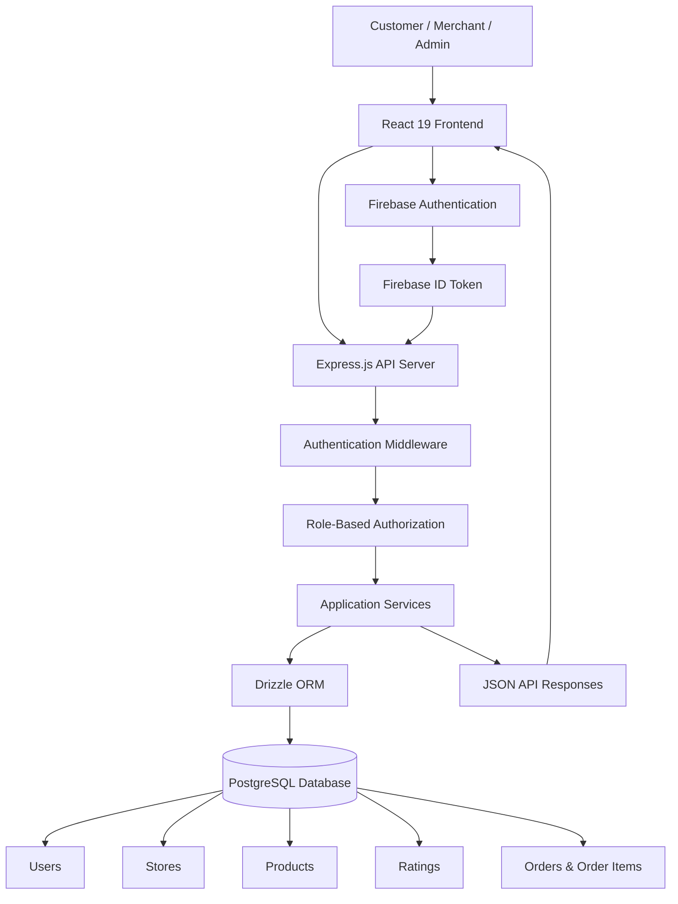

# 🛍️ StorePulse — Curated Storefront & Verified Store Ratings

<p align="center">

  **Discover Better. Shop Confidently. Trust Verified Stores.**

  A full-stack curated shopping platform that brings independent stores, thoughtfully selected products, customer reviews, and merchant management together in one seamless experience.

  **Built with React, TypeScript, Express.js, Firebase & PostgreSQL**

</p>

---

## 🌿 Overview

Online shopping should be more than browsing endless product listings. Customers deserve a curated shopping experience where discovering quality products and evaluating store credibility go hand in hand.

**StorePulse** is a full-stack e-commerce platform designed to connect customers with curated independent stores through a clean storefront, transparent store ratings, and dedicated merchant and administrator portals.

The platform combines a premium editorial-style shopping interface with a structured backend that manages products, inventory, customer accounts, orders, and store reviews.

Whether customers are discovering products, merchants are managing their collections, or administrators are overseeing the marketplace, StorePulse provides a unified experience built around simplicity and trust.

> **Our vision:** Make online shopping feel more curated, transparent, and trustworthy.

---

## ✨ Key Features

### 1. 🛒 Curated Shopping Experience

Explore a thoughtfully organized storefront featuring products from independent stores.

**Features:**
- Premium editorial-style storefront interface.
- Curated product collections.
- Product categories and featured products.
- Product detail modal with descriptions and specifications.
- Product pricing and availability.
- Store information alongside product listings.
- Store discovery and browsing.
- Responsive shopping experience.

### 2. ⭐ Verified Store Ratings & Reviews

StorePulse puts store credibility at the center of the shopping experience.

**Features:**
- Verified store directory.
- Store-level customer ratings.
- Five-star rating system.
- Customer-written review comments.
- Average store rating calculations.
- Total review counts.
- Recent customer reviews.
- Individual customer rating history.
- One rating record per customer per store, updated when they submit another review.

Customers can evaluate stores based on the experiences shared by other shoppers.

### 3. 🛍️ Smart Shopping Bag & Checkout

A convenient shopping flow for selecting products and placing orders.

**Features:**
- Add products to shopping bag.
- Update product quantities.
- Remove individual products.
- Automatic subtotal calculation.
- Stock-aware quantity limits.
- Checkout form with customer and delivery details.
- Multiple payment method selections:
  - Cash on Delivery (COD)
  - Bank Transfer
  - Card on Delivery
- Server-side product price validation.
- Inventory availability verification.
- Transaction-based order creation.
- Order confirmation and order history.

**Inventory protection:** Product stock is checked and decremented within a database transaction to help prevent overselling.

### 4. 👤 Customer Account & Order Management

A dedicated account experience for signed-in customers.

**Features:**
- Google authentication using Firebase.
- Customer profile management.
- Update personal name and delivery address.
- View previous orders.
- Access order details and order statuses.
- View and update store ratings.
- Personalized account experience.

### 5. 🏪 Merchant Portal

A dedicated workspace for store owners to manage their business activities.

**Features:**
- Merchant dashboard.
- Store-specific product management.
- Add new products.
- Update product names and prices.
- Manage inventory quantities.
- Activate or deactivate products.
- View customer ratings and reviews.
- View store orders.
- Track revenue and units sold.
- Monitor low-stock products.
- Update order fulfillment statuses.

Merchants can manage their own stores, while system administrators have broader management access.

### 6. 🛡️ Admin Portal

A centralized administration dashboard for marketplace oversight.

**Features:**
- Platform-wide overview.
- Total registered users.
- Total stores.
- Total customer ratings.
- Total orders.
- Gross revenue metrics.
- User management.
- Role management.
- Store registration and ownership assignment.
- Store and product overview.
- Platform order overview.

**User roles:**
- `USER` — Regular customer.
- `STORE_OWNER` — Merchant managing assigned stores.
- `SYSTEM_ADMIN` — Platform administrator.

Role-based authorization is enforced on protected backend routes.

---

## 🏗️ System Architecture

StorePulse follows a full-stack architecture with a React frontend, Express API server, Firebase authentication, and PostgreSQL database.



---

## 🛠️ Technology Stack

| Layer | Technology |
|---|---|
| Frontend | React 19 |
| Programming Language | TypeScript |
| Styling | Tailwind CSS v4 |
| Animations | Motion |
| Icons | Lucide React |
| Backend | Node.js |
| API Framework | Express.js |
| Authentication | Firebase Authentication |
| Server Authentication | Firebase Admin SDK |
| Database | PostgreSQL |
| ORM | Drizzle ORM |
| Build Tool | Vite |
| Package Manager | npm / Bun |

---

## 📂 Project Structure

```text
StorePulse/
│
├── public/
│   └── favicon.svg
│
├── src/
│   ├── assets/
│   │   └── images/              # Product and storefront images
│   │
│   ├── components/
│   │   ├── StorefrontView.tsx   # Main shopping interface
│   │   ├── ProductDetailModal.tsx
│   │   ├── RatingModal.tsx
│   │   ├── BagDrawer.tsx
│   │   ├── AccountView.tsx
│   │   ├── MerchantPortalView.tsx
│   │   ├── AdminPortalView.tsx
│   │   ├── StorePulseLogo.tsx
│   │   └── SafeImage.tsx
│   │
│   ├── context/
│   │   └── AuthContext.tsx      # Authentication context
│   │
│   ├── db/
│   │   ├── index.ts             # Database connection
│   │   ├── schema.ts            # Database schema
│   │   ├── queries.ts           # Database operations
│   │   └── drizzle.config.ts
│   │
│   ├── lib/
│   │   ├── firebase.ts          # Firebase client setup
│   │   ├── firebase-admin.ts    # Firebase Admin setup
│   │   └── format.ts            # API and formatting utilities
│   │
│   ├── middleware/
│   │   └── auth.ts              # Authentication and authorization
│   │
│   ├── types/
│   │   └── storepulse.ts        # TypeScript interfaces
│   │
│   ├── App.tsx
│   ├── index.css
│   └── main.tsx
│
├── server.ts                    # Express API server
├── firebase-applet-config.json  # Firebase project configuration
├── .env.example
├── package.json
├── vite.config.ts
└── README.md
```

---

## ⚙️ Getting Started

Follow these steps to run StorePulse locally.

### Prerequisites

Make sure you have:

- Node.js installed.
- npm installed.
- A Firebase project with Google Authentication configured.
- A PostgreSQL database.
- Access to the required database credentials.

### 1. Clone the Repository

```bash
git clone <YOUR_GITHUB_REPOSITORY_URL>

cd StorePulse
```

### 2. Install Dependencies

```bash
npm install
```

### 3. Configure Environment Variables

Create a `.env` file in the project root.

```env
# PostgreSQL Database
SQL_HOST=your_database_host
SQL_USER=your_database_user
SQL_PASSWORD=your_database_password
SQL_DB_NAME=your_database_name

# Database migration credentials
SQL_ADMIN_USER=your_database_admin_user
SQL_ADMIN_PASSWORD=your_database_admin_password
```

The project also uses:

- `firebase-applet-config.json` for Firebase client and server project configuration.
- Firebase Admin SDK for verifying authentication tokens.
- `APP_URL` where required by your deployment environment.

Use the provided `.env.example` as a starting point for configuration. Never commit database passwords or private credentials.

### 4. Set Up the Database

StorePulse uses PostgreSQL with Drizzle ORM.

The schema is defined in:

```text
src/db/schema.ts
```

Configure the database connection and Drizzle migration credentials before running database migrations.

### 5. Start the Development Server

```bash
npm run dev
```

Open the local URL displayed in your terminal.

### 6. Build for Production

```bash
npm run build
```

### 7. Run TypeScript Checks

```bash
npm run lint
```

---

## 🔌 API Reference

StorePulse exposes REST API endpoints through its Express.js backend.

### Public & Customer APIs

| Method | Endpoint | Description |
|---|---|---|
| GET | `/api/catalog` | Retrieve stores, products, ratings and catalog summary |
| GET | `/api/me` | Get authenticated user profile |
| PATCH | `/api/me` | Update user profile |
| POST | `/api/ratings` | Submit or update a store rating |
| POST | `/api/orders` | Create a customer order |
| GET | `/api/orders/mine` | Retrieve current user's orders |

### Merchant APIs

| Method | Endpoint | Description |
|---|---|---|
| GET | `/api/merchant/overview` | Retrieve merchant dashboard data |
| POST | `/api/merchant/products` | Add a product |
| PATCH | `/api/merchant/products/:id` | Update product information |
| PATCH | `/api/merchant/orders/:id/status` | Update order fulfillment status |

### Administrator APIs

| Method | Endpoint | Description |
|---|---|---|
| GET | `/api/admin/overview` | Retrieve platform analytics and overview |
| POST | `/api/admin/stores` | Register a new store |
| PATCH | `/api/admin/users/:id/role` | Update a user's platform role |

**Security:** Protected routes require a valid Firebase ID token. Merchant and administrator endpoints additionally enforce role-based permissions.

---

## 🗄️ Database Design

StorePulse uses a relational PostgreSQL database managed through Drizzle ORM.

The application consists of six primary entities:

| Table | Purpose |
|---|---|
| `users` | Customer, merchant, and administrator profiles |
| `stores` | Store information, ownership, and verification status |
| `products` | Product details, prices, and inventory |
| `ratings` | Customer store reviews and ratings |
| `orders` | Customer checkout and order information |
| `order_items` | Individual products included in orders |

### Key Relationships

- A user can own multiple stores.
- A store can contain multiple products.
- A store can receive multiple customer ratings.
- A user can submit one rating per store.
- A user can create multiple orders.
- An order can contain multiple order items.
- Each order item references its product and store.

---

## 🔒 Security & Data Integrity

StorePulse incorporates several backend safeguards:

- Firebase ID token verification.
- Role-based access control.
- Protected merchant and administrator routes.
- Server-side input validation.
- Server-authoritative product pricing.
- Inventory availability checks during checkout.
- Atomic stock decrement operations.
- Transaction-based order creation.
- Restricted product image paths.
- Database relationships and foreign-key constraints.
- Unique customer-store rating records.

These safeguards help maintain consistent marketplace data and prevent unauthorized operations.

---

## 💡 What Makes StorePulse Different?

Traditional shopping platforms primarily focus on product discovery and checkout.

StorePulse brings together three important marketplace experiences:

| Marketplace Challenge | StorePulse Solution |
|---|---|
| Finding quality products | Curated storefront |
| Evaluating store credibility | Customer ratings and verified store directory |
| Managing independent businesses | Dedicated merchant portal |
| Managing marketplace operations | Centralized admin dashboard |
| Maintaining inventory accuracy | Transaction-based stock management |
| Building customer relationships | Accounts, reviews, and order history |

**The central idea:** A better shopping experience starts with better discovery and greater transparency.

---

## 🚀 Future Enhancements

Potential improvements for future versions include:

- Online payment gateway integration.
- Product search, filtering, and advanced sorting.
- Wishlist and saved products.
- Product-level customer reviews.
- Real-time order tracking.
- Email and SMS order notifications.
- Merchant sales analytics and downloadable reports.
- Enhanced store verification workflows.
- Product recommendation engine.
- Multi-currency support.
- Automated fraud and suspicious-review detection.
- Automated database backups and audit logs.

---

## 🏆 Project Information

**Project Name:** StorePulse  
**Category:** Full-Stack E-Commerce / Marketplace Platform  
**Architecture:** React + Express.js + PostgreSQL  
**Authentication:** Firebase  
**ORM:** Drizzle ORM  

**Live Demo:** (https://storepulse-curated-storefront-verified-store-rati.ai.studio/)
([https://storepulse-curated-storefront-verified-store-rati.ai.studio](https://storepulse-curated-storefront-verified-store-rati.ai.studio)).

**GitHub Repository:** (https://github.com/prachimahajan192008/storepulse-marketplace).

---

## ❤️ Final Note

StorePulse is built around a simple belief:

**Shopping should be about discovering great products and knowing the people and stores behind them.**

By combining curated discovery, transparent store ratings, and dedicated business management tools, StorePulse aims to create a more trustworthy and enjoyable shopping ecosystem.

**StorePulse — Discover Better. Shop Confidently. Trust Verified Stores.**
